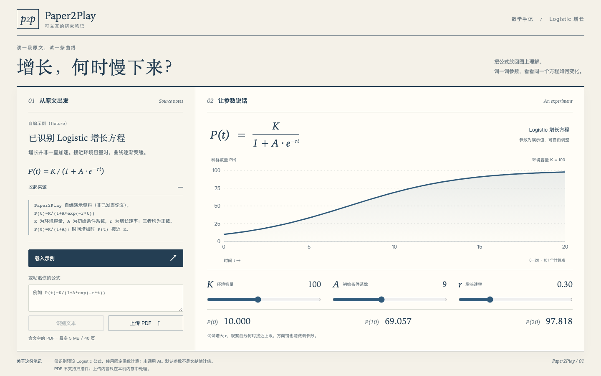
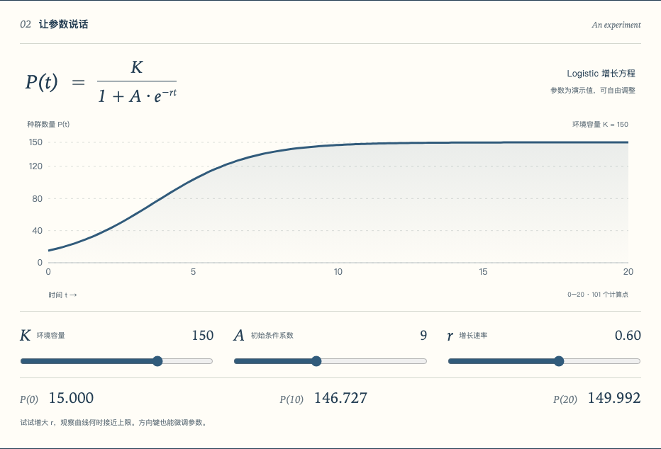

# Paper2Play

**公式看懂了，参数一改会怎样？拖一下就知道。**

Logistic 增长方程里，增长速率变大和环境容量变大，是同一回事吗？
Paper2Play 把原文、公式和可调曲线放在一张研究笔记上。左边保留来源，右边改变参数，看数值怎样跟着变化。



### 让一个公式，变成能动手试的例子

学生可以边读边试，老师可以拿它解释“增长得更快”和“最终容纳更多”的区别。你不必先写绘图代码，也不用在 PDF 和计算器之间来回切。

目前专注一个方程：`P(t)=K/(1+A*exp(-r*t))`。支持粘贴文字或上传含文字的 PDF，识别受支持的表达式后显示曲线与来源。无需账号或 API Key，没有调用 AI。

### 在本机打开

准备 **Node.js 24 LTS** 与 npm（也支持 22.13+ 的 22 系列及 26+；不支持 23/25），然后运行：

```sh
git clone https://github.com/shenyangs/paper2play.git
cd paper2play
npm run setup
npm run doctor
npm run dev
```

浏览器打开 [http://127.0.0.1:4209](http://127.0.0.1:4209)，终端保持运行；结束时按 Ctrl+C。首次 setup 会联网安装依赖与测试浏览器，下载时间取决于网络。安装问题见 [使用手册](docs/usage.md)。

### 用两个参数，看出两种变化

1. 点击 **载入示例**。这是项目自编资料，默认 K=100、A=9、r=0.30。
2. 把 **r 增长速率**调到 0.60：P(10) 从 **69.057** 变为 **97.818**。
3. 再把 **K 环境容量**调到 150：P(10) 变为 **146.727**。点击 **查看来源**，回到原文核对。



你也可以上传仓库内的 [示例 PDF](fixtures/logistic.pdf)：公式位于第 2 页，用它试一次提取与页码定位。输入 `E=mc²` 会明确提示暂不支持，不会猜一条曲线。

### 先把这一个模型讲明白

当前只识别预设 Logistic 文字表达式，不理解任意论文、LaTeX 或等价公式。参数是演示值，不是从论文估计出来的，也不验证科学结论。

PDF 必须含文字，最多 5 MB、40 页，不支持 OCR。输入只在本机内存处理，不上传远程服务、不执行用户公式代码。通用“论文转实验”尚未实现。

### 想继续看代码或验证结果

本地构建、单元测试、浏览器流程和演示录屏已经在 macOS 通过；README 配图来自实际运行的应用。Windows / Linux 实机与全新机器完整安装尚未验证。所有服务仅监听本机，没有部署所需的账号与鉴权，请勿直接暴露到公网。

停止开发服务后，可自行运行：

```sh
npm run build
npm run test
npm run e2e
npm run demo
```

[安装、排错与实现细节](docs/usage.md) · [验证记录与当前状态](status.json) · [MIT 许可](LICENSE)
